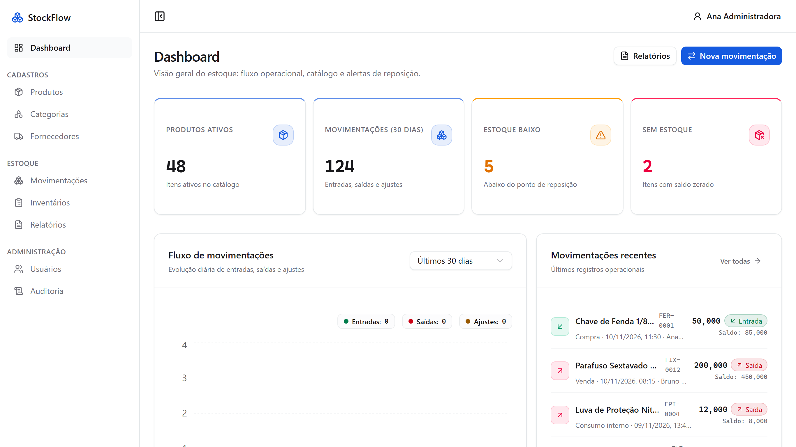
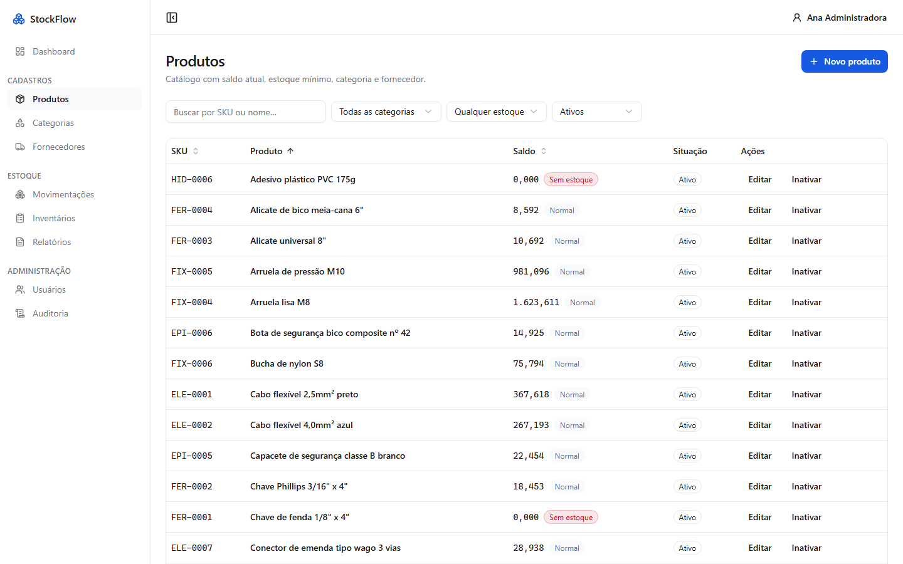
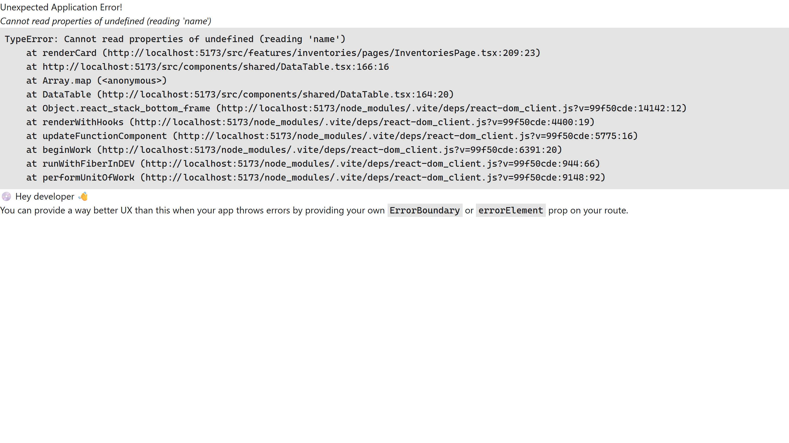
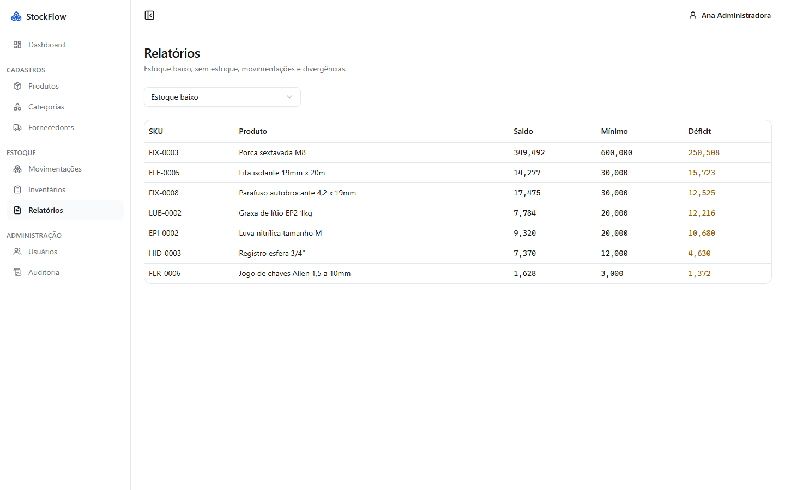
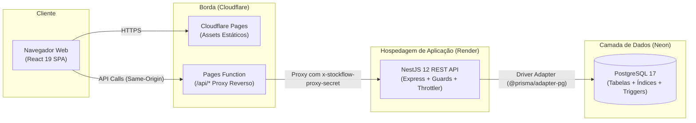

# StockFlow

> Sistema corporativo Full Stack de gestão de estoque, controle operacional e rastreabilidade logística para pequenas e médias empresas.

[](https://stockflow-6zb.pages.dev)
[](https://github.com/pedr0coder/stockflow/actions)
[](https://nestjs.com/)
[](https://react.dev/)
[](https://www.prisma.io/)
[](https://www.postgresql.org/)

---

## 🌐 Demonstração Online

- **Aplicação Web:** [https://stockflow-6zb.pages.dev](https://stockflow-6zb.pages.dev)
- **Status do Backend:** [https://stockflow-6zb.pages.dev/api/v1/health/ready](https://stockflow-6zb.pages.dev/api/v1/health/ready)
- **Modo Demonstração Interativo (Sem Login):** Clique em **"Entrar sem login (Demo)"** na tela inicial, informe seu nome ou apelido e explore todas as operações de catálogo, movimentações, inventários e relatórios em uma sandbox isolada por sessão, sem alterar o banco de dados real.

---

## 📋 Visão Geral e Problema Resolvido

O controle de estoque em empresas em crescimento frequentemente depende de planilhas manuais ou sistemas legados suscetíveis a inconsistências críticas:

- Edições simultâneas que sobrescrevem registros sem rastro de auditoria;
- Saldos calculados de forma arbitrária sem comprovação histórica de entradas e saídas;
- Falta de visibilidade tempestiva sobre itens abaixo do ponto de reposição ou em ruptura;
- Divergências de contagem física sem fluxo seguro de apuração e aprovação gerencial;
- Dificuldade em justificar contabilmente perdas, avarias ou consumos internos.

O **StockFlow** resolve esses gargalos tratando o **saldo de estoque como uma consequência transacional imutável**: nenhuma tela ou endpoint permite editar diretamente a quantidade de um item. Cada alteração de saldo decorre exclusivamente de uma movimentação auditada (`IN`, `OUT` ou `ADJUSTMENT`) contendo quantidade, custo, autor, data, motivo normatizado e saldos anterior e posterior registrados de forma atômica.

---

## 📸 Interface da Aplicação

### Dashboard Analítico

Visão executiva em tempo real: indicadores de catálogo, alertas de estoque baixo/zerado e fluxo operacional diário.


### Catálogo de Produtos

Listagem paginada com ordenação dinâmica, busca com debounce e badges de situação de estoque.


### Histórico de Movimentações

Rastreabilidade total: tipo, motivo operacional, quantidade, saldo resultante, autor e atalhos diretos ao produto com SKU.


### Inventários Físicos e Cíclicos

Abertura de contagens, cálculo automatizado de divergências e fluxo de aprovação com conciliação contábil.


### Relatórios Gerenciais

Exportação e visualização de relatórios de estoque baixo, itens sem estoque e conciliação analítica.


---

## ✨ Funcionalidades Principais

- **Autenticação e Sessão Robusta:** tokens JWT de curta duração em memória combinados com refresh tokens rotativos em cookies `HttpOnly`, `Secure` e `SameSite=Strict`.
- **Controle de Acesso Baseado em Papéis (RBAC):** matriz de permissões estrita no backend (`ADMIN`, `MANAGER`, `OPERATOR`) com autorização verificada por guards do NestJS.
- **Transações Atômicas e Concorrência Segura:** movimentações processadas dentro de transações PostgreSQL isoladas (`READ COMMITTED` / `SELECT ... FOR UPDATE`), impedindo que duas baixas simultâneas levem o estoque a saldo negativo.
- **Rastreabilidade e Auditoria Imutável:** tabela de auditoria (`audit_logs`) com registro de login, alterações de papel, atualizações cadastrais e reconciliações de inventário.
- **Gestão de Inventários em 2 Fases:** abertura de lotes de contagem, lançamento de contagem física e aprovação restrita a gerentes/administradores com geração automática de ajustes.
- **Interface SaaS Moderna e Responsiva:** design corporativo construído com Tailwind CSS v4, tipografia nítida, paleta refinada, gráficos vetoriais via Recharts e acessibilidade total (WCAG / WAI-ARIA).

---

## 🛠️ Tecnologias Utilizadas

### Frontend

- **React 19.3** — renderização reativa com hooks modernos e streaming;
- **TypeScript 5.9** — tipagem estrita de ponta a ponta sem tipos `any`;
- **Vite 8** — empacotamento com divisão determinística de vendor chunks;
- **Tailwind CSS 4** — estilização moderna utilitária com design system `@theme`;
- **Recharts 3.10** — gráficos analíticos e temporais de movimentações;
- **TanStack React Query 5** — sincronização de estado com cache inteligente e invalidação seletiva;
- **TanStack React Table 9** — tabelas com ordenação, paginação e filtros no servidor;
- **React Hook Form + Zod** — formulários tipados com validação declarativa;
- **Lucide Icons** — iconografia vetorial consistente.

### Backend

- **Node.js 24** — runtime JavaScript corporativo de alto desempenho;
- **NestJS 12.1** — arquitetura modular com injeção de dependência estrita;
- **Prisma 7.10** — ORM moderno com driver adapter `@prisma/adapter-pg`;
- **PostgreSQL 17** — banco relacional com chaves UUIDv7 e precisão monetária `Decimal(14,4)`;
- **Argon2id (`@node-rs/argon2`)** — algoritmo de hashing resistente a GPU conforme recomendação NIST/OWASP;
- **Passport JWT** — estratégia de validação de tokens stateless;
- **Throttler Guard** — limitação de taxa (rate limiting) contra ataques de força bruta no login e refresh;
- **Pino Logger** — logging estruturado em JSON com UUIDv7 por requisição e higienização automática de segredos.

### Infraestrutura e Deploy

- **Cloudflare Pages + Functions** — hospedagem estática global (Edge) e proxy reverso same-origin (`/api/*`);
- **Render Free Web Service** — execução do backend Node.js em container com inicialização segura e migração automática;
- **Neon PostgreSQL** — banco de dados relacional gerenciado sem expiração;
- **Docker & Docker Compose** — orquestração local de desenvolvimento e testes de integração;
- **GitHub Actions** — pipeline de CI/CD automatizado com validação de lint, testes e builds.

---

## 🏛️ Arquitetura do Sistema



---

## 🔒 Segurança e Autenticação

1. **Defesa em Profundidade contra Forjamento de IP:** a comunicação entre o proxy de borda (Cloudflare) e o backend (Render) é autenticada através de um segredo compartilhado (`x-stockflow-proxy-secret`). Requisições diretas não autenticadas em produção são rejeitadas com `HTTP 403`, evitando bypass de rate limit via cabeçalhos forjados (`X-Forwarded-For`).
2. **Proteção contra Brute Force:** rate limiting de 5 tentativas a cada 15 minutos por par `(IP, Email)` no login e 30 renovações a cada 15 minutos no refresh.
3. **Mitigação de Timing Attacks:** o login calcula hashes comparáveis mesmo para e-mails inexistentes e utiliza `crypto.timingSafeEqual` na verificação do segredo do proxy.
4. **Isolamento de Credenciais:** o campo `passwordHash` é omitido nativamente pelo cliente Prisma em todas as consultas da aplicação (`omit: { user: { passwordHash: true } }`), exigindo solicitação explícita apenas no serviço de autenticação.

---

## 📦 Como Executar Localmente

### Pré-requisitos

- **Docker Desktop** e **Node.js 24+** instalados.

### 1. Clonar o repositório

```bash
git clone https://github.com/pedr0coder/stockflow.git
cd stockflow
```

### 2. Configurar variáveis de ambiente

Copie os arquivos de exemplo para a raiz e para o frontend:

```bash
cp .env.example .env
cp frontend/.env.example frontend/.env
```

Gere segredos criptográficos seguros para o `.env`:

```bash
node -e "console.log(require('crypto').randomBytes(48).toString('base64url'))"
```

### 3. Iniciar com Docker Compose

```bash
docker compose up -d
```

O compose inicializará:

- **PostgreSQL 17:** `localhost:5432`
- **Backend NestJS:** `http://localhost:3000` (Swagger em `http://localhost:3000/api/docs`)
- **Frontend Vite:** `http://localhost:5173`

### 4. Popular banco com dados de demonstração

```bash
npm --prefix backend run seed
```

**Credenciais padrão de demonstração:**

- Administrador: `admin@stockflow.local`
- Gerente: `gerente@stockflow.local`
- Operador: `operador@stockflow.local`

---

## 🧪 Testes Automatizados

O StockFlow adota uma cultura rigorosa de qualidade com mais de **780 testes automatizados**:

### Backend

```bash
# Testes unitários (319 testes)
npm --prefix backend run test

# Testes de integração com banco PostgreSQL real (465 testes)
npm --prefix backend run test:int

# Linter e verificação de tipos
npm --prefix backend run lint
npm --prefix backend run typecheck
```

### Frontend

```bash
# Testes unitários de interface e contratos (289 testes)
npm --prefix frontend run test

# Linter e verificação de tipos
npm --prefix frontend run lint
npm --prefix frontend run typecheck

# Build de produção
npm --prefix frontend run build
```

---

## 🚀 Processo de Deploy e CI/CD

- **GitHub Actions:** a cada push na branch `main`, a esteira executa checagem de formatação (Prettier), lint, typecheck, testes unitários e testes de integração.
- **Deploy Automático:**
  - **Render:** detecta alterações na `main`, executa `npm run build`, aplica migrations com `prisma migrate deploy` e reinicia o serviço;
  - **Cloudflare Pages:** compila o frontend com Vite e publica os arquivos estáticos e as Pages Functions globalmente.

---

## 👤 Autor

Desenvolvido por **Pedro** ([@pedr0coder](https://github.com/pedr0coder)).

Projeto concebido para demonstração de arquitetura robusta, boas práticas de segurança, design de software corporativo e entrega de ponta a ponta.
